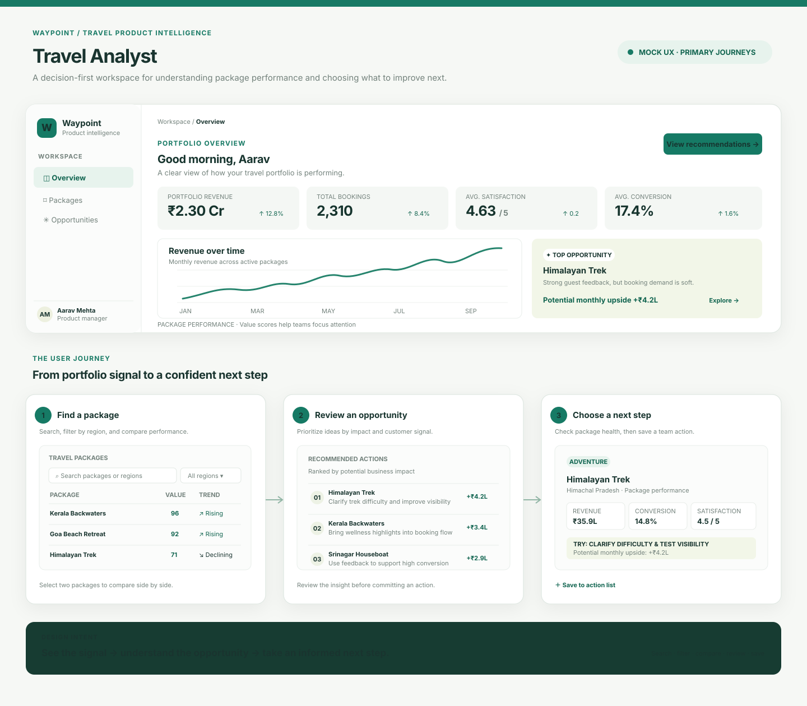

# Travel Product Optimization Dashboard

Travel Analyst helps travel teams understand package performance and prioritize product improvements using bookings, revenue, satisfaction, conversion, and value scores.

## Stack

- Frontend: React + Vite
- Backend: Node.js + Express

## Mock UX Design

[Open the public UX storyboard](./docs/mock-ux-flow.svg) · [Explore the interactive prototype](./docs/mock-ux.html)

This design maps the dashboard-to-decision journey: review portfolio signals, filter and compare packages, explore an opportunity, and save a next step. The storyboard is previewable on GitHub; the prototype demonstrates the key interactions.

